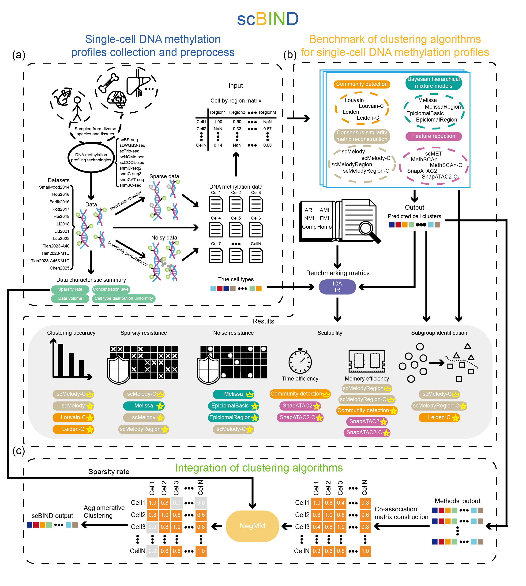

# scBIND: a systematic benchmark and robust integration of clustering algorithms for single-cell DNA methylation profiles

We performed a comprehensive benchmarking analysis and robust integration of 17 methods for clustering single‑cell DNA methylation profiles. This evaluation not only provides researchers with an in‑depth comparison of available approaches to facilitate method selection for practical research scenarios, but also establishes a robust clustering strategy, namely, the integration of state‑of‑the‑art methods. We further hope that this work will inspire future methodological advances and contribute to the continued development of the field.

## Pipeline of our study



The pipeline of our study consists of three main stages: **a,** scDNAm profiles collection and preprocess; **b,** Benchmark of clustering algorithms of scDNAm profiles; **c,** Integration of clustering algorithms. Crowns denote methods that achieve the best performance in a corresponding assessment aspect, while stars indicate methods with relatively better performance.

## Repository description

We provide all scripts required to run and evaluate the methods described in this study, as well as to reproduce the results. The directory structure is organized as follows:

1. The **`methods`** folder includes the source scripts for each method, along with intermediate files containing processed input data. Each method has a dedicated subfolder, with the exception of EpiclomalBasic and EpiclomalRegion, which are integrated within a shared framework.
2. The **`input_adjust`** folder contains scripts for converting raw data into method‑specific input formats. These scripts handle three types of data adjustments: (1) constructing cell‑by‑region h5ad files from raw data; (2) building detailed cell‑by‑region h5ad files that include methylation and total counts per region, tailored for scMET input; (3) generating intermediate files from an h5ad file for MelissaRegion input.

## Setting up Anaconda environments for methods

The required Anaconda environments for each method are provided in the RAR package at [Google Drive](https://drive.google.com/file/d/1ZGzVEck-_20LGRSD7QMczFP2lSQ5PS50/view?usp=drive_link).

Users can extract the files to access the environment configurations for each tool:

- `Louvain.rar`: Contains the environment for `Louvain`, `Louvain-C`, `Leiden`, `Leiden-C`, and `scBIND`.
- `Melissa.rar`: Contains the Anaconda environment for running `Melissa` and `MelissaRegion`.
- `Epiclomal.rar`: Provides the environment for both `EpiclomalBasic` and `EpiclomalRegion`.
- `scMelody.rar`: Includes the environment for `scMelody`, `scMelody-C`, `scMelodyRegion`, and `scMelodyRegion-C`.
- `scMET.rar`: Offers the environment for `scMET`.
- `MethSCAn.rar`: Provides the environment for `MethSCAn` and `MethSCAn-C`.
- `SnapATAC2.rar`: Contains the environment for `SnapATAC2` and `SnapATAC2-C`.

## Adjustment of your datasets to fit method-specific inputs

To ensure compatibility with our processing pipeline, the datasets require a few adjustments to fit method‑specific inputs. First, we assume that users have already prepared the following:

1. `raw_data` folder: This folder contains several `.gz` files, each representing the DNA methylation information of a corresponding cell. These files must meet the following requirements:

   - The files must be in **tab-delimited format**.

   - The files **must not include a header row** with the column names.

2. `true_clone_membership.txt.gz`: This file must contain the pre-annotated true cell types in the following format:

   ```
   cell_id epigenotype_id
   GSM2324443_CLP_1_D1_10_R1       0
   GSM2324444_CLP_1_D1_11_R1       0
   GSM2324445_CLP_1_D1_13_R1       0
   GSM2324446_CLP_1_D1_14_R1       0
   GSM2324497_CMP_1_D2_10_R1       1
   GSM2324498_CMP_1_D2_11_R1       1
   GSM2324499_CMP_1_D2_12_R1       1
   GSM2324502_CMP_1_D2_15_R1       1
   ```

   The columns represent:

   - `cell_id`: the identifier for each cell

   - `epigenotype_id`: the corresponding true cell type label

   Requirements for this file:

   - The file must be in **tab-delimited format**.
   - Rows must be sorted in **lexicographic ascending order** of the `cell_id` column.
   - The file **must include a header row** with the column names.

Next, we describe adjustments for method‑specific inputs.

- `-S` format cell files: Users need to adjust methods to accept cell files in the `Smallwood2014`-like format, for example:

  ```
  7    45282	45282	100.0	2   0
  7    86551	45282	100.0	1   0
  7    108126 108126	0.0		0   5
  7    203233 203233	20.0	1   4
  ```

  Each row corresponds to one DNA methylation locus in a single cell, with the columns representing:

  1. `chromosome`
  2. `position`
  3. `position`
  4. `beta value` * 100, namely `methylated reads` / `unmethylated reads` * 100
  5. `methylated reads`
  6. `unmethylated reads`

- `-F` format cell files: Users need to adjust methods to accept cell files in the `Farlik2016`-like format, for example:

  ```
  7    45282	2   2
  7    86551	1   1
  7    108126 0   5
  7    203233 1   5
  ```

  Each row corresponds to one DNA methylation locus in a single cell, with the columns representing:

  1. `chromosome`
  2. `position`
  3. `methylated reads`
  4. `total reads`

- `h5ad` file: A cell‑by‑region matrix derived from `raw_data`. Users may have already obtained `h5ad` file (must be **lexicographic ascending order**) or can generate the `h5ad` file using `build.py` and `run_build.sh` located in the **`input_adjust`** folder, based on `raw_data` and `true_clone_membership.txt.gz`. This `h5ad` file contains all cell‑by‑region information for clustering and evaluation. Users need to specify parameters in `run_build.sh` as follows:

  - `bed_path`: Path to your `raw_data` folder.
  - `h5adpath`: Path to save the constructed `h5ad` file.
  - `chrom`: Column number of chromosome information in each single‑cell file within `raw_data`.
  - `pos`: Column number of methylation position in each single‑cell file within `raw_data`.
  - `met`: Column number of methylated reads in each single‑cell file within `raw_data`.
  - `tot`: Column number of total reads in each single‑cell file within `raw_data`.
  - `species`: Set to `MOUSE` or `HUMAN`.
  - `mm_refgenome`: If `species` is set to `MOUSE`, specify the genome library of your data (e.g., the `Smallwood2014` dataset uses the `mm10` genome). Otherwise, set this to `None`.
  - `hg_refgenome`: If `species` is set to `HUMAN`, specify the genome library of your data (e.g., the `Farlik2016` dataset uses the `hg38` genome). Otherwise, set this to `None`.
  - `window_width`: Number of methylation loci to include per region. In our work, this is set to `10000`.
  - `groundtruth`: Path to your `true_clone_membership.txt.gz` file.

  Then execute:

  ```bash
  bash run_build.sh
  ```

- `constructed_met` and `constructed_tot` files: Detailed cell‑by‑region matrices containing methylation and total reads for each region, tailored for `scMET` input. Users can generate these two files using `build_scMET.py` and `run_build_scMET.sh` in the **`input_adjust`** folder, based on `raw_data` and `true_clone_membership.txt.gz`. Parameters  should be specified in `run_build_scMET.sh` in the same manner as in `run_build.sh`, then run:

  ```bash
  bash run_build_scMET.sh
  ```

- `transformed_h5ad` folder: Intermediate files containing region‑level methylation information derived from the `h5ad` file, intended for `MelissaRegion` input. Users can generate these files using `build_Region.py` and `run_build_Region.sh` in the **`input_adjust`** folder, based on the `h5ad` file. Parameters should be specified in `run_build.sh` including path to your `h5ad` file and the folder to save `transformed_h5ad`, then run:

  ```bash
  bash run_build_Region.sh
  ```

We provide `Farlik2016` dataset as an example of all input data formats at [Google Drive](https://drive.google.com/file/d/1m677-F78fob-1GDeHuZoGBm_F22bq8pa/view?usp=drive_link).

## Run methods

We now describe how to execute all methods, covering the required environment, input data format, and detailed parameters.

### Run Louvain

- Environments require: `Louvain`.
- Input data format: `h5ad` file.

Please navigate to the `methods/Louvain/` directory. The parameters in `run.sh` are described as follows:

- `h5adpath`: Path to your `h5ad` file.
- `predcluster`: Path to save the clustering outcome. The clustering outcome will be will be saved as `Louvain.csv`.
- `savepath`: Path to save the evaluation of clustering outcome. The evaluation through six benchmark metrics ARI, AMI, FMI, NMI, Comp and Homo will be saved as `Evaluation_Louvain.csv`.

Next, execute the following bash command:

```bash
bash run.sh
```

This will run the script and redirect both standard output and standard error to the file `log`.

### Run Louvain-C

- Environments require: `Louvain`.
- Input data format: `h5ad` file.

Please navigate to the `methods/Louvain-C/` directory. The parameters in `run.sh` are described as follows:

- `h5adpath`: Path to your `h5ad` file.
- `predcluster`: Path to save the clustering outcome. The clustering outcome will be will be saved as `Louvain-C.csv`.
- `savepath`: Path to save the evaluation of clustering outcome. The evaluation through six benchmark metrics ARI, AMI, FMI, NMI, Comp and Homo will be saved as `Evaluation_Louvain-C.csv`.
- `n_clusters`: User-predefined number of clusters.

Next, execute the following bash command:

```bash
bash run.sh
```

This will run the script and redirect both standard output and standard error to the file `log`.

### Run Leiden

- Environments require: `Louvain`.
- Input data format: `h5ad` file.

Please navigate to the `methods/Leiden/` directory. The parameters in `run.sh` are described as follows:

- `h5adpath`: Path to your `h5ad` file.
- `predcluster`: Path to save the clustering outcome. The clustering outcome will be will be saved as `Leiden.csv`.
- `savepath`: Path to save the evaluation of clustering outcome. The evaluation through six benchmark metrics ARI, AMI, FMI, NMI, Comp and Homo will be saved as `Evaluation_Leiden.csv`.

Next, execute the following bash command:

```bash
bash run.sh
```

This will run the script and redirect both standard output and standard error to the file `log`.

### Run Leiden-C

- Environments require: `Louvain`.
- Input data format: `h5ad` file.

Please navigate to the `methods/Leiden-C/` directory. The parameters in `run.sh` are described as follows:

- `h5adpath`: Path to your `h5ad` file.
- `predcluster`: Path to save the clustering outcome. The clustering outcome will be will be saved as `Leiden-C.csv`.
- `savepath`: Path to save the evaluation of clustering outcome. The evaluation through six benchmark metrics ARI, AMI, FMI, NMI, Comp and Homo will be saved as `Evaluation_Leiden-C.csv`.
- `n_clusters`: User-predefined number of clusters.

Next, execute the following bash command:

```bash
bash run.sh
```

This will run the script and redirect both standard output and standard error to the file `log`.

### Run Melissa

- Environments require: `Melissa`.
- Input data format: `-F` format cell files and `true_clone_membership.txt.gz` file.

Please navigate to the `methods/Melissa/` directory. The parameters in `run.sh` are described as follows:

- `input_path`: Path to your folder containing `-F` format cell files.
- `groundtruth`: Path to your `true_clone_membership.txt.gz` file.
- `predcluster`: Path to save the clustering outcome. The clustering outcome will be will be saved as `Melissa.csv`.
- `savepath`: Path to save the evaluation of clustering outcome. The evaluation through six benchmark metrics ARI, AMI, FMI, NMI, Comp and Homo will be saved as `Evaluation_Melissa.csv`.
- `n_clusters`: User-predefined number of clusters.

Next, execute the following bash command:

```bash
bash run.sh
```

This will run the script and redirect both standard output and standard error to the file `log`.

### Run MelissaRegion

- Environments require: `Melissa`.
- Input data format: `transformed_h5ad` folder and `true_clone_membership.txt.gz` file.

Please navigate to the `methods/MelissaRegion/` directory. The parameters in `run.sh` are described as follows:

- `transformpath`: Path to your `transformed_h5ad` folder.
- `groundtruth`: Path to your `true_clone_membership.txt.gz` file.
- `predcluster`: Path to save the clustering outcome. The clustering outcome will be will be saved as `MelissaRegion.csv`.
- `savepath`: Path to save the evaluation of clustering outcome. The evaluation through six benchmark metrics ARI, AMI, FMI, NMI, Comp and Homo will be saved as `Evaluation_MelissaRegion.csv`.
- `n_clusters`: User-predefined number of clusters.

Next, execute the following bash command:

```bash
bash run.sh
```

This will run the script and redirect both standard output and standard error to the file `log`.

### Run EpiclomalBasic and EpiclomalRegion

- Environments require: `Epiclomal`.
- Input data format: `-F` format cell files and `true_clone_membership.txt.gz` file.

Please navigate to the `methods/Epiclomal/` directory. Please modify `config.yaml` file and `cpgIslandExt.txt` under `config/process_real_data/` folder. Specifically, for `config/process_real_data/config.yaml` file, update the following variables to match your data:

- `COV_DIR` (line 6): Path to your folder containing `-F` format cell files.
- `TRUE_FILE`: Path to your `true_clone_membership.txt.gz` file. This parameter is also needed to specify for `config.yaml` file under `config/real_data/` folder.

- `CELL_PATTERN` (line 8): Specify the filename extension of the single-cell files. For example, if your files are named like `GSM2324994_MPP_1_D4_8_R1.txt.gz`, set `CELL_PATTERN: ".txt.gz"`.
- `GENOME_LIBRARY` (line 15): Specify the genome library corresponding to your dataset. For example, `Farlik2016` datasets belong to `hg38` genome library, then set `GENOME_LIBRARY: 'BSgenome.Hsapiens.UCSC.hg38'`.

For `config/process_real_data/cpgIslandExt.txt` file, you need to download the appropriate CpG island annotation file from [UCSC Genome Browser Downloads](https://hgdownload.soe.ucsc.edu/downloads.html) according to your genome assembly. Let's see an example for `Farlik2016` dataset (`hg38` genome library):

1. Go to the UCSC download page.
2. Select `Human genomes` → `hg38` → `Annotations` → `SQL table dump annotations`.
3. Download `cpgIslandExt.txt.gz`, extract it, and replace the existing file.
4. Add a header to the file with the following columns: `chr`, `start`, `end`. The file should follow this format (tab-delimited):

```
x1 chr start end x5 x6 x7 x8 x9 x10 x11 x12
585     chr1    28735   29737   CpG: 111        1002    111     731     22.2    73      0.85
586     chr1    135124  135563  CpG: 30	439     30      295     13.7    67.2    0.64
586     chr1    199251  200121  CpG: 104        870     104     643     23.9    73.9    0.89
587     chr1    368792  370063  CpG: 99 1271    99      777     15.6    61.1    0.84
```

This file must satisfy:

- The file must be in **tab-delimited format**.

- The second, third, and fourth columns must be named `chr`, `start`, and `end`, respectively.

Next, execute the following bash command under `methods/Epiclomal/` folder:

```bash
bash run.sh
```

This will run the script and redirect both standard output and standard error to the file `log`. The clustering results and their evaluation based on the six benchmark metrics will be saved as `Epiclomal.csv`, `Evaluation_EpiclomalBasic.csv` and `Evaluation_EpiclomalRegion.csv` respectively in the `result` directory.

### Run scMelody

- Environments require: `scMelody`.
- Input data format: `-F` format cell files and `true_clone_membership.txt.gz` file.

Please navigate to the `methods/scMelody/` directory. The parameters in `run.sh` are described as follows:

- `input_path`: Path to your folder containing `-F` format cell files.
- `groundtruth`: Path to your `true_clone_membership.txt.gz` file.
- `predcluster`: Path to save the clustering outcome. The clustering outcome will be will be saved as `scMelody.csv`.
- `savepath`: Path to save the evaluation of clustering outcome. The evaluation through six benchmark metrics ARI, AMI, FMI, NMI, Comp and Homo will be saved as `Evaluation_scMelody.csv`.

Next, execute the following bash command:

```bash
bash run.sh
```

This will run the script and redirect both standard output and standard error to the file `log`.

### Run scMelody-C

- Environments require: `scMelody`.
- Input data format: `-F` format cell files and `true_clone_membership.txt.gz` file.

Please navigate to the `methods/scMelody-C/` directory. The parameters in `run.sh` are described as follows:

- `input_path`: Path to your folder containing `-F` format cell files.
- `groundtruth`: Path to your `true_clone_membership.txt.gz` file.
- `predcluster`: Path to save the clustering outcome. The clustering outcome will be will be saved as `scMelody-C.csv`.
- `savepath`: Path to save the evaluation of clustering outcome. The evaluation through six benchmark metrics ARI, AMI, FMI, NMI, Comp and Homo will be saved as `Evaluation_scMelody-C.csv`.
- `n_clusters`: User-predefined number of clusters.

Next, execute the following bash command:

```bash
bash run.sh
```

This will run the script and redirect both standard output and standard error to the file `log`.

### Run scMelodyRegion

- Environments require: `scMelody`.
- Input data format: `h5ad` file and `true_clone_membership.txt.gz` file.

Please navigate to the `methods/scMelodyRegion/` directory. The parameters in `run.sh` are described as follows:

- `h5adpath`: Path to your `h5ad` file.
- `groundtruth`: Path to your `true_clone_membership.txt.gz` file.
- `predcluster`: Path to save the clustering outcome. The clustering outcome will be will be saved as `scMelodyRegion.csv`.
- `savepath`: Path to save the evaluation of clustering outcome. The evaluation through six benchmark metrics ARI, AMI, FMI, NMI, Comp and Homo will be saved as `Evaluation_scMelodyRegion.csv`.

Next, execute the following bash command:

```bash
bash run.sh
```

This will run the script and redirect both standard output and standard error to the file `log`.

### Run scMelodyRegion-C

- Environments require: `scMelody`.
- Input data format: `h5ad` file and `true_clone_membership.txt.gz` file.

Please navigate to the `methods/scMelodyRegion-C/` directory. The parameters in `run.sh` are described as follows:

- `h5adpath`: Path to your `h5ad` file.
- `groundtruth`: Path to your `true_clone_membership.txt.gz` file.
- `predcluster`: Path to save the clustering outcome. The clustering outcome will be will be saved as `scMelodyRegion-C.csv`.
- `savepath`: Path to save the evaluation of clustering outcome. The evaluation through six benchmark metrics ARI, AMI, FMI, NMI, Comp and Homo will be saved as `Evaluation_scMelodyRegion-C.csv`.
- `n_clusters`: User-predefined number of clusters.

Next, execute the following bash command:

```bash
bash run.sh
```

This will run the script and redirect both standard output and standard error to the file `log`.

### Run scMET

- Environments require: `scMET`.
- Input data format: `constructed_met` and `constructed_tot` files and `true_clone_membership.txt.gz` file.

Please navigate to the `methods/scMET/` directory. The parameters in `run.sh` are described as follows:

- `h5admet`: Path to your `constructed_met` file.
- `h5adtot`: Path to your `constructed_tot` file.
- `threshold_cover`: The minimum number of cells that a region must cover (i.e., the required number of non‑NaN entries per region) to ensure algorithmic convergence.
- `threshold_min_mean`: The minimum mean methylation level a region must have to ensure algorithmic convergence.
- `threshold_max_mean`: The maximum mean methylation level a region must have to ensure algorithmic convergence.
- `groundtruth`: Path to your `true_clone_membership.txt.gz` file.
- `predcluster`: Path to save the clustering outcome. The clustering outcome will be will be saved as `scMET.csv`.
- `savepath`: Path to save the evaluation of clustering outcome. The evaluation through six benchmark metrics ARI, AMI, FMI, NMI, Comp and Homo will be saved as `Evaluation_scMET.csv`.
- `n_clusters`: User-predefined number of clusters.

Next, execute the following bash command:

```bash
bash run.sh
```

This will run the script and redirect both standard output and standard error to the file `log`.

### Run MethSCAn

- Environments require: `MethSCAn`.
- Input data format: `-S` format cell files and `true_clone_membership.txt.gz` file.

Please navigate to the `methods/MethSCAn/` directory. The parameters in `run.sh` are described as follows:

- `input_path`: Path to your folder containing `-S` format cell files.
- `output_path`: Path to save intermediate files generated by `MethSCAn`. Users need to create a new folder named `compact_data` to store these files.
- `output_VMRs`: Path to save the variably methylated regions (VMRs) identified by `MethSCAn`. Users can create a new folder named `VMR` to save this information as `VMRs.bed`.
- `output_VMR_matrix`: Path to save the VMR information transformed from `VMRs.bed`. Users can create a new folder named `VMR_matrix` under the `VMR` folder to store this information.
- `groundtruth`: Path to your `true_clone_membership.txt.gz` file.
- `predcluster`: Path to save the clustering outcome. The clustering outcome will be will be saved as `MethSCAn.csv`.
- `savepath`: Path to save the evaluation of clustering outcome. The evaluation through six benchmark metrics ARI, AMI, FMI, NMI, Comp and Homo will be saved as `Evaluation_MethSCAn.csv`.

Next, execute the following bash command:

```bash
bash run.sh
```

This will run the script and redirect both standard output and standard error to the file `log`.

### Run MethSCAn-C

- Environments require: `MethSCAn`.
- Input data format: `-S` format cell files and `true_clone_membership.txt.gz` file.

Please navigate to the `methods/MethSCAn-C/` directory. The parameters in `run.sh` are described as follows:

- `input_path`: Path to your folder containing `-S` format cell files.
- `output_path`: Path to save intermediate files of `MethSCAn`. Users need to newly build a folder `compact_data` for saving these files.
- `output_VMRs`: Path to save variably methylated regions (VMRs) identified by `MethSCAn`. Users can newly build a folder `VMR` for save these information as `VMRs.bed`
- `output_VMR_matrix`: Path to save VMR information transformed from `VMRs.bed`. Users can newly build a folder `VMR_matrix` under `VMR` folder for saving these information.
- `groundtruth`: Path to your `true_clone_membership.txt.gz` file.
- `predcluster`: Path to save the clustering outcome. The clustering outcome will be will be saved as `MethSCAn-C.csv`.
- `savepath`: Path to save the evaluation of clustering outcome. The evaluation through six benchmark metrics ARI, AMI, FMI, NMI, Comp and Homo will be saved as `Evaluation_MethSCAn-C.csv`.
- `n_clusters`: User-predefined number of clusters.

Next, execute the following bash command:

```bash
bash run.sh
```

This will run the script and redirect both standard output and standard error to the file `log`.

### Run SnapATAC2

- Environments require: `SnapATAC2`.
- Input data format: `h5ad` file and `true_clone_membership.txt.gz` file.

Please navigate to the `methods/SnapATAC2/` directory. The parameters in `run.sh` are described as follows:

- `h5adpath`: Path to your `h5ad` file.
- `groundtruth`: Path to your `true_clone_membership.txt.gz` file.
- `predcluster`: Path to save the clustering outcome. The clustering outcome will be will be saved as `SnapATAC2.csv`.
- `savepath`: Path to save the evaluation of clustering outcome. The evaluation through six benchmark metrics ARI, AMI, FMI, NMI, Comp and Homo will be saved as `SnapATAC2.csv`.

Next, execute the following bash command:

```bash
bash run.sh
```

This will run the script and redirect both standard output and standard error to the file `log`.

### Run SnapATAC2-C

- Environments require: `SnapATAC2`.
- Input data format: `h5ad` file and `true_clone_membership.txt.gz` file.

Please navigate to the `methods/SnapATAC2-C/` directory. The parameters in `run.sh` are described as follows:

- `h5adpath`: Path to your `h5ad` file.
- `groundtruth`: Path to your `true_clone_membership.txt.gz` file.
- `predcluster`: Path to save the clustering outcome. The clustering outcome will be will be saved as `SnapATAC2-C.csv`.
- `savepath`: Path to save the evaluation of clustering outcome. The evaluation through six benchmark metrics ARI, AMI, FMI, NMI, Comp and Homo will be saved as `SnapATAC2-C.csv`.
- `n_clusters`: User-predefined number of clusters.

Next, execute the following bash command:

```bash
bash run.sh
```

This will run the script and redirect both standard output and standard error to the file `log`.

### Run scBIND

- Environments require: `Louvain`.
- Input data format: `methods.csv` file and `true_clone_membership.txt.gz` file. The `methods` parameter takes a value from the following set:
  `{"Louvain", "Louvain-C", "Leiden", "Leiden-C", "Melissa", "MelissaRegion", "EpiclomalBasic", "EpiclomalRegion", "scMelody", "scMelody-C", "scMelodyRegion", "scMelodyRegion-C", "scMET", "MethSCAn", "MethSCAn-C", "SnapATAC2", "SnapATAC2-C"}`.

Please navigate to the `methods/scBIND/` directory. The parameters in `run.py` are described as follows:

- `methods` (line 5): The list of methods to be integrated. We recommend not including both a method and its variant that accepts a predefined number of clusters. For example, users should include only one of `Louvain` and `Louvain-C` in the `methods` list (we recommend the `-C` variant, namely `Louvain-C`, to improve clustering outcomes).
- `n_cell` (line 9): Number of cells.
- `n_clusters` (line 10): User-predefined number of clusters.
- `missing_rate` (line 11): The sparsity rate of the `h5ad` file for your dataset. Users can compute this by dividing the number of NaN values in the cell‑by‑region matrix by the total number of entries in the matrix.
- Paths to results aggregated from the methods in the list (lines 16, 20, and 23), which need to be specified.
- Path to your `true_clone_membership.txt.gz` file (line 80), which needs to be specified.

Next, execute the following bash command:

```bash
bash run.sh
```

This will run the script and redirect both standard output and standard error to the file `log`. The clustering outcomes and evaluation results will be saved as `scBIND.csv` and `Evaluation_scBIND.csv` respectively in the `result` folder.
